# Linda³ (PC Engine Super CD-ROM²) English translation v0.3

An unofficial fan translation patch. It contains only the changes to the game's
data track, not the game: you need your own disc image of **Linda3 (Japan, Rev 2)**.

**[Download the patch (v0.3)](https://github.com/suddenlythis/linda3pce-english/releases/tag/v0.3)**
 · [How to install](INSTALL.md) · [Checksums](SHA1SUMS.txt)

  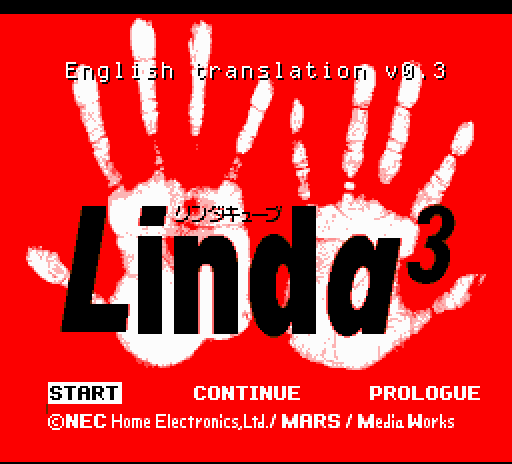

## Progress

Although this is numbered 0.3, most of the work is done. What is left is
subtitling the rest of the cutscenes, then stability and testing, before it can
leave this beta phase.

| Area | Status | Details |
|---|---|---|
| English font and text system | Done | A new half-width Latin font, English stored compressed so each scene's script fits in the space its Japanese had, and boxes and menus resized to the English |
| Dialogue, all three scenarios (A, B, C) | Done | About 4,700 distinct lines |
| Place names | Done | 1,125 name boxes, shown on entering a room, a town or an area |
| Menus and choices | Done | Shops, the bank, the main menu, the status screen, the save-file and scenario menus, the pause settings. A few are abbreviated to fit |
| Names | Done | Animals, items, equipment, food, abilities and towns: about 1,000 |
| Battle screens | Done | Command menu, prompts, attack, damage, recovery and level-up lines, effect names, stat labels, the hound's name under its HP |
| English text entry (naming a hound) | Done | The kana grid replaced by an English one (A-Z, a-z, hyphen, space). Names are 2 to 4 letters |
| Subtitle system for voiced cutscenes | Working, still being extended | Draws the text as sprites in time with the voices. Fitting it into the memory of the remaining scenes is being worked on |
| Voice-only cutscenes | 6 subtitled, about 10 to go | Done: the intro narration, the Chief's recap at the meeting, four more story cutscenes. Not yet: the prologue and the rest |
| Staff credits | Not translated | Left as they are, on purpose |
| Text that is part of a picture | Not translated | The title logo, the PAUSE box, the opening credit sections after the first |
| Tested on | Mednafen 1.32.1 | Also started and played briefly on RetroArch with the Beetle PCE core. Not tested on other emulators or on real hardware |

Details are in [What is in English](#what-is-in-english),
[What was changed in the game](#what-was-changed-in-the-game),
[Not translated](#not-translated) and [Known issues](#known-issues) below.

## About the game

Linda3 (written "Linda" with a superscript 3, read "Linda Cube". Japanese title
リンダキューブ) is a role-playing game for the PC Engine Super CD-ROM2.

| | |
|---|---|
| Released | 13 October 1995, Japan only |
| Publisher | NEC Home Electronics |
| Developer | Alfa System (with MARS Corporation) |
| Created by | Shoji Masuda |

It was never released outside Japan. It was later remade for the PlayStation as
"Linda3 Again" (1997) and for the Sega Saturn as "Linda3 Kanzenban" (1998).
This patch is for the original PC Engine version only, the section below says
how that differs from the PlayStation version, which has its own English
translation.

The setting is the colony planet Neo Kenya. A comet is on course to destroy it
in eight years. An ark arrives to carry life off the planet, and the ranger Ken
Challenger is registered as its crew: before time runs out he has to collect
the planet's animals, a male and a female of each kind, with his partner Linda.

What you do:

- Hunt and capture animals across the planet, season by season, against the
  countdown. There are 100 species to register.
- Fight battles with Ken, Linda and a hound you buy, are given or catch.
- Turn animals into gear (weapons, clothes, hats, shoes) and food.
- Play three separate scenarios from the same starting point: A "MERRY X'MAS",
  B "HAPPY CHILD" and C "ASTRO ARK". Each tells a different story with the same
  cast. A and B have to be cleared before C opens.

**Content note:** the game is known for how dark it is. Its stories include
murder, gore, body horror, abuse and cruelty, played straight. It was made for
adults. This translation does not tone any of that down.

## Screenshots

  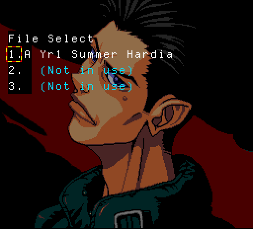
  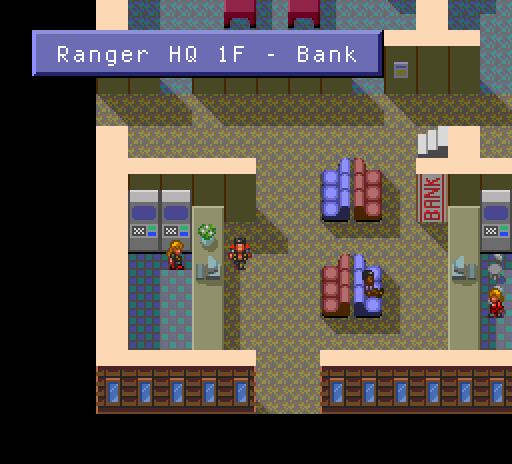
  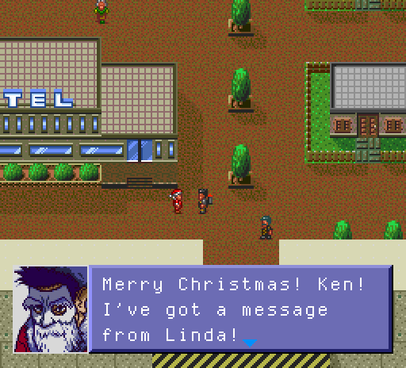

  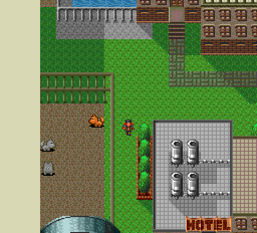
  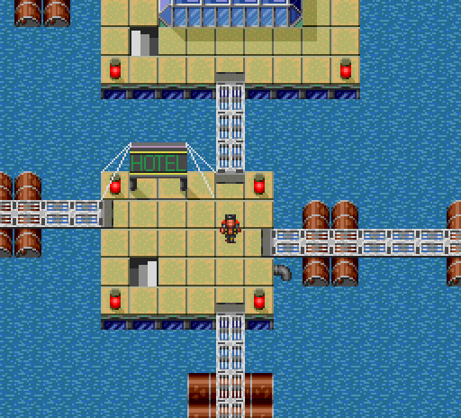
  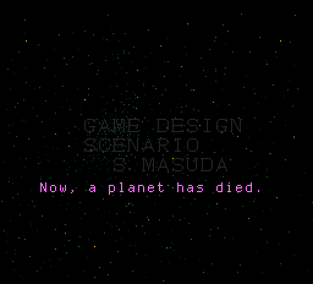

  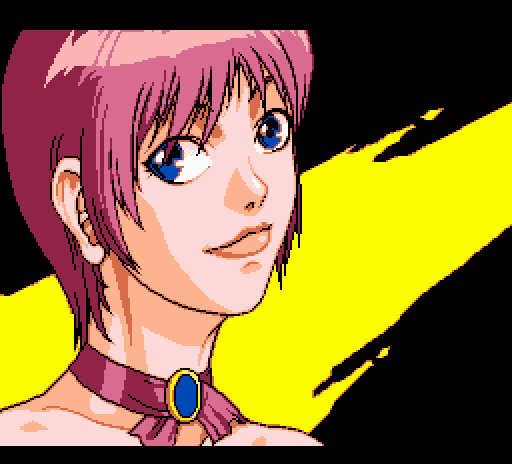
  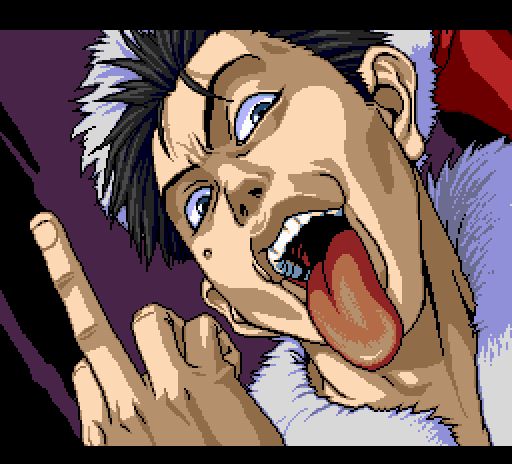
  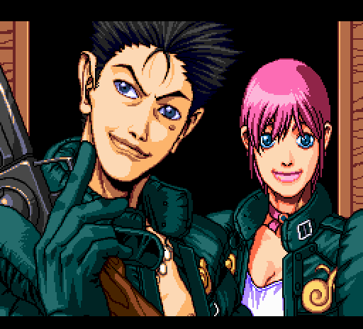

  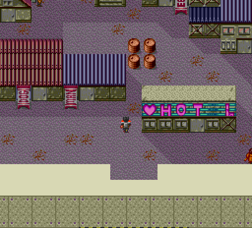
  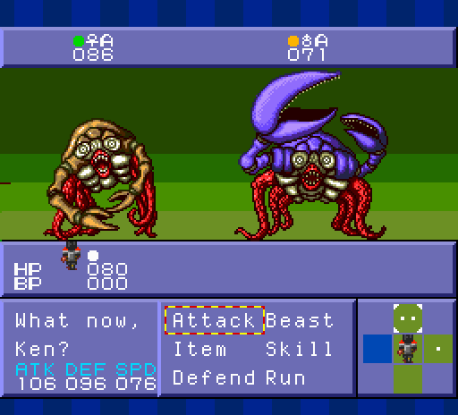
  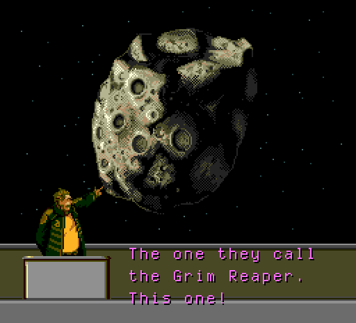

## This version and the PlayStation version

There are three versions of the game:

| Version | Platform | Released | Publisher |
|---|---|---|---|
| Linda3 | PC Engine | 13 Oct 1995 | NEC Home Electronics |
| Linda3 Again | PlayStation | 25 Sep 1997 | Sony Computer Entertainment |
| Linda3 Kanzenban | Sega Saturn | 18 Jun 1998 | ASCII |

"Again" is a remake, not a port, and "Kanzenban" is close to "Again" with a
few extras. This patch is for the first one: the 1995 original.

- The 1995 PC Engine original carried an 18+ advisory for its violent and
  grotesque scenes.
- The 1997 PlayStation remake, Linda³ Again, softened some of that. A Japanese
  retrospective says the depictions were relaxed for the PlayStation, and the
  readme of the fan translation of Again says the biggest story changes and
  cuts came with that release.
- One concrete example is listed: an early scene where Linda and Ken kiss in
  the original was changed so that she punches him.
- The 1998 Saturn version is described as restoring some of what the
  PlayStation release cut.

An English fan translation of the PlayStation remake already exists. This
patch is a separate project made from the PC Engine game's own Japanese text,
it does not use that translation.

How the two differ, as far as is documented. The points about the remake come
from published write-ups and from the notes of the PlayStation translation,
not from a comparison made for this patch.

| | PC Engine original (this patch) | PlayStation remake |
|---|---|---|
| **Content** | As first written. It got a high age rating in Japan for its violence. | Toned down. The PlayStation translators' notes say the largest story changes and cuts came with this version. |
| **Story and names** | The 1995 script. | Some story elements, character names, scenes and animal designs changed or removed. |
| **Character art** | The original designs. | Redrawn, the designs are very different. |
| **Cutscenes** | Still pictures drawn by the program, with voice and no text. | Animated cutscenes. |
| **Graphics** | 1995 PC Engine graphics. | Reworked throughout. |
| **Scenarios** | Three: A, B and C. | Four: a fourth was added, described as a time trial with little story. |
| **English** | This patch, v0.3: early, with gaps (see below). | Complete, released 2024. |

In short: the remake is the more polished game and has the finished English
translation. The original is the game as it was first made, with the content
the remake softened, and until now it could not be played in English at all.

## Installing

1. Get the zip from the [v0.3 release](https://github.com/suddenlythis/linda3pce-english/releases/tag/v0.3).
2. Patch your Track 02 file with `Linda3-EN-v0.3.xdelta`, keeping its file name.
3. Open your usual `.cue`.

Your Track 02 must have SHA-1 `3296a4db58a92a60dfbd35fc99a8c1943db995e1`
before patching, and will have `86abb01a2dd40a48d19e7293575468ce1170887e`
afterwards. The full steps, for Delta Patcher and for the command line, are in
**[INSTALL.md](INSTALL.md)**.

Start a new game or boot fresh after patching. A save state made on the Japanese
game or on an older version of the patch keeps showing the old text until the
game loads that area again. In-game saves are not affected.

## About this translation

Version 0.3 is an early release, made to find out whether the patch works on
other people's copies. It should be playable from start to finish in English,
but it has not been played through and needs more testing. Please see
"Known issues".

Not all cutscenes are translated yet.

AI was used to assist with the code and translation.

Six of the cutscenes are subtitled. Around ten remain, including the prologue:
managing the memory to draw the subtitles in scenes is proving to be
cumbersome, and I wanted to get this release out as it is and see if people were
interested.

## What is in English

- All dialogue in all three scenarios (A, B, C): about 4,700 distinct lines.
- Place names shown on entering a room, a town or an area (1,125 name boxes).
- Menus and choices, shops, the bank, the main menu, the status screen, the
  save-file and scenario menus, the pause settings.
- Animal, item, equipment, food, ability and town names (about 1,000).
- Battle screens: the command menu, prompts, attack, damage, recovery and
  level-up lines, effect names, the stat labels, and the hound's name under
  its HP.
- The grid for naming a hound (A-Z, a-z, hyphen, space. Names are 2 to 4
  letters).
- Subtitles for six voice-only cutscenes. These scenes have speech and no text
  anywhere on the disc, so the lines were transcribed by ear and by machine,
  translated, and drawn on screen in time with the voices:
  - the intro narration
  - the Chief's recap at the meeting ("...shall I recap?" - Yes)
  - four more story cutscenes, one of them with a Yes / No choice

## What was changed in the game

Text alone would not fit: Japanese says more per character, and every scene
has a fixed amount of room. So besides the words, the patch changes how the
game stores and draws them. Nothing about the rules, the story, the difficulty
or the content was changed.

**Text storage**

- English is stored compressed (a dictionary of common letter pairs on top of
  the game's own compression) so that each scene's script fits in the space
  its Japanese script had.
- The game now reads its text as English. The few lines still in Japanese are
  flagged so they display properly instead of as garbage.

**Font**

- A new half-width Latin font (capitals, lowercase, digits, punctuation)
  replaces the game's half-width character set.
- The three small stat labels, which are pictures in the original, were
  redrawn as ATK, DEF and SPD.

**Boxes and menus**

- Place-name boxes are sized to the English name by the patch (850 of 1,125
  were widened, long names use two lines).
- Selector frames in choice menus were re-spaced so that the frame sits on its
  own option, some menus got a wider frame (the bank, the pause settings).
- The battle command menu was widened and given a larger selector. It now
  reads Attack / Beast, Item / Skill, Defend / Run.
- Several windows were widened or moved by a cell or two (pause settings,
  gear and skill titles, shop money boxes).
- The save-file list (CONTINUE) was widened to the full screen and its rows
  shortened to fit: a row reads "1.A Yr1 Summer Hardia" (file, scenario, year,
  season, place).

**Names**

- The name-entry screen uses an English grid in place of the kana grid.
- Under a hound's HP in battle the original shows the first two kana of its
  name, and a small "Champ" picture for any name it cannot show. English names
  always took that fallback, so the routine was replaced: it now shows up to
  four letters of the name in capitals (the small font has no lowercase).

**Cutscene subtitles**

- A small routine added to each subtitled cutscene program draws the text as
  sprites, its text and font sit in unused sectors of the disc.

## Not translated

- Voice-only cutscenes: six are subtitled. Around ten are not yet, including
  the prologue. In those you will hear Japanese speech with no text.
- The staff credits (left as they are, on purpose).
- Text that is part of a picture: the title logo, the PAUSE box, and the
  opening credit sections after the first.

## Known issues

**Wrong or missing**

- Hound names are 2 to 4 letters (the original allows 4 kana). The name grid
  has no digits.
- Two script lines that are shared between scenes still appear in Japanese.

**Cut short to fit**

- The main menu bar is abbreviated: "Bag Kit Skl Dog T.C. Sts Nav".
- One body-part menu and one fruit menu use very short forms
  ("Hr/Br/Ns/C/E/Lp/Nk/Hn", "Bana Strw WMel Apri").
- The airport desk menu has "Gab" for "chat".
- About 50 lines were reworded more tightly than the Japanese to fit their
  boxes.
- A hound's name under its HP in battle is shown in capitals.

**Layout**

- In the bank menu the selector on the last option pokes a few pixels past the
  edge of the box.
- In the battle menu the selector on "Attack" ends about two pixels from the
  next word.

**Subtitles for cutscenes**

- Timing and wording: the recap was checked line by line against the audio in
  play.

## Technical

- Only Track 02 is changed (396 byte ranges). The audio tracks are untouched.
- The patched track is the same size as the original, sector error-correction
  data is recomputed for every changed sector.
- Building with no patches applied reproduces the original track exactly.
- Tested mainly on Mednafen 1.32.1. Also started and played briefly on
  RetroArch with the Beetle PCE core. Not tested on other emulators or on real
  hardware.

## Version history

**v0.3, 2026-11-12.** First packaged release. Full script, menus, names, battle
screens, six subtitled cutscenes, version line on the title screen. Rebuilt
twice the same day, still as 0.3, with fixes found in play: place-name boxes
that showed only the last letter of the name, the shop money box, and the
save-file list. The checksum under "Installing" identifies the current build.

---

This is an unofficial, non-commercial fan work. Linda3 and everything in it
belong to their owners. The patch contains no game data that can be used
without an original disc image.
